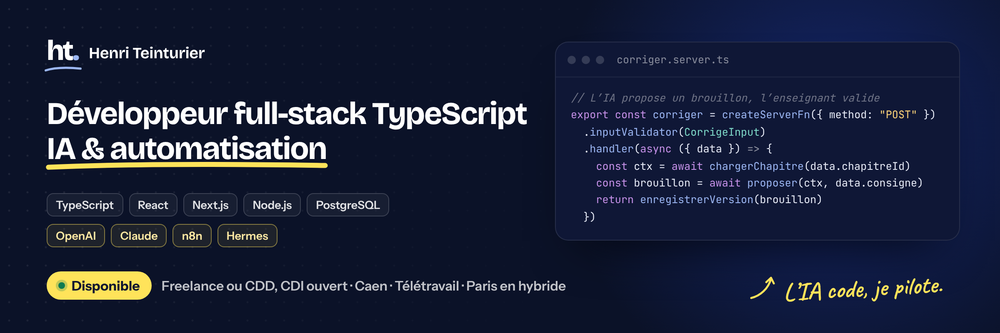
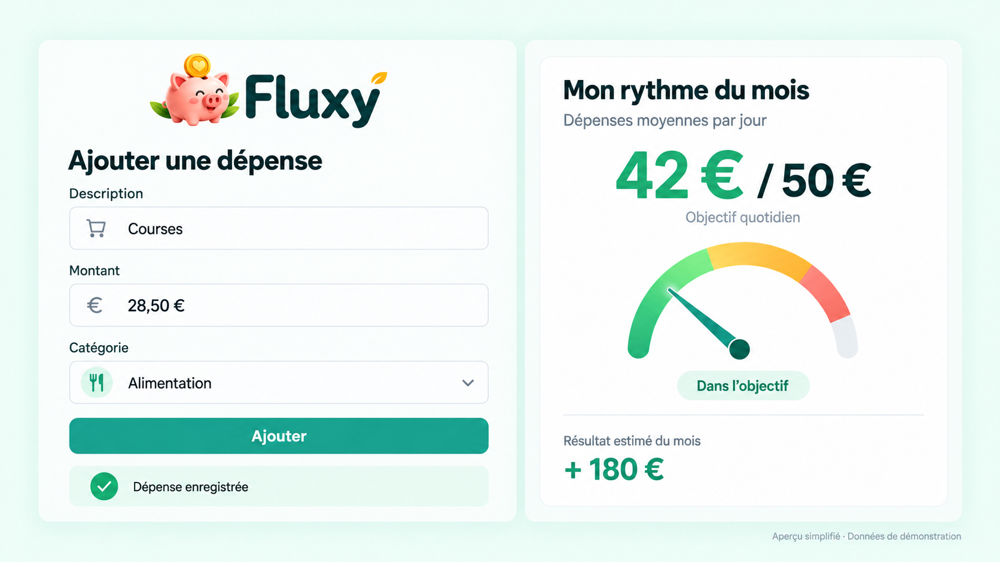

  

  
  &nbsp;
  

## Développeur full-stack, l’IA en plus

Je conçois des applications web complètes : base de données, logique serveur, interface et mise en production. J’y intègre l’IA quand elle apporte vraiment quelque chose : préparer un brouillon, résumer, classer, ou faire travailler deux outils ensemble.

Je développe chaque jour avec **Claude Code et Codex** : je cadre le besoin, je fais les choix d’architecture, je teste en conditions réelles et je mets en production.

> **Je cherche** une mission freelance ou un CDD, CDI ouvert : développement web, IA appliquée, automatisation. 
> **Caen et Normandie, télétravail, ou Paris en hybride (deux jours sur place).**

## Ce que j’apporte

- **Des produits livrés de bout en bout** : trois applications en ligne, que je conçois, développe, déploie et utilise.
- **De l’IA intégrée proprement** : appels côté serveur, brouillons versionnés et validés par l’utilisateur, génération de documents et de PDF. Premier projet RAG (pgvector) en 2024.
- **De l’automatisation** : n8n et agents IA auto-hébergés (Hermes) sur VPS, que j’approfondis en ce moment.
- **De la transmission** : formateur Git (M2I) et CI/CD GitHub Actions.
- **Le sens du terrain** : 13 ans à diriger deux restaurants en franchise, jusqu’à 35 personnes. Aujourd’hui aussi professeur de maths en collège, d’où Séquencia.

## Parcours

- **Développeur chez Nooco**, startup parisienne : deux ans en équipe agile.
- **Formateur** Git (M2I) et CI/CD GitHub Actions, en 2025.
- **Professeur de mathématiques** en collège depuis 2026, en parallèle de mes applications.
- **Titre professionnel** de développeur web.
- **Avant** : 13 ans à diriger deux restaurants en franchise.

## Projets

### Séquencia · préparer ses cours avec l’IA

Utilisée en classe. L’IA (API OpenAI, côté serveur) propose exercices, évaluations et corrigés à partir des documents du chapitre ; l’enseignant ajuste, compare les versions et valide. Rendu PDF avec Puppeteer, partage d’un chapitre par lien en lecture seule révocable, mode projection.

`React` `TypeScript` `TanStack Start` `PostgreSQL` `OpenAI` `Puppeteer` `Vercel`

[Voir l’application →](https://cours-college.vercel.app/presentation) · [Présentation et architecture](https://github.com/HenriTeinturier/sequencia-presentation)

### Thesia · suivi de portefeuille PEA et CTO

Opérations, positions et liquidités par compte ; gains latents, gains réalisés et dividendes calculés à partir des mouvements ; cotations Yahoo Finance ; accès authentifié.

`React` `TypeScript` `TanStack Start` `TanStack Query` `PostgreSQL` `Prisma` `Better Auth`

[Voir l’accueil →](https://thesia.henriteinturier.com) · [Présentation et architecture](https://github.com/HenriTeinturier/thesia-presentation)

### Fluxy · budget du foyer

Saisie rapide des dépenses, récurrents avec rappels et changements de tarif, estimation de fin de mois, budget partagé entre les membres du foyer.

`React` `TypeScript` `TanStack Start` `PostgreSQL` `Prisma` `Better Auth` `Zod`

[Voir l’application →](https://fluxy-pied.vercel.app/) · [Présentation et architecture](https://github.com/HenriTeinturier/fluxy-presentation)

Le code de ces trois applications est privé, car elles manipulent des données personnelles. Je peux en montrer des extraits en entretien.

### Et aussi

- **[henriteinturier.com](https://henriteinturier.com)** : site Astro sur Vercel, formulaire serverless (Cloudflare Turnstile, Resend), SEO et données structurées.
- **[RAG sur la documentation Next.js](https://github.com/HenriTeinturier/ScrapEmbeddingNextjsDoc)** (2024) : scraping, embeddings OpenAI et pgvector sur Neon, puis [une interface de questions-réponses](https://github.com/HenriTeinturier/Talk-To-NextJsDoc-With-OpenAi).
- **[Démo Docker multi-services](https://github.com/HenriTeinturier/docker-demo-react-vite-express-nginx-mongodb)** : Nginx en reverse proxy, React, Express et MongoDB.
- **[Atelier CI/CD GitHub Actions](https://github.com/HenriTeinturier/todolist-github-actions-solution)** : workflows, protection de branches et environnements, avec son [dépôt de départ](https://github.com/HenriTeinturier/todolist-github-action-starter).

## Stack

**IA et automatisation** : OpenAI · Claude · Vercel AI SDK · RAG (pgvector) · n8n · Hermes 
**Développement avec l’IA** : Claude Code · Codex 
**Aussi** : TanStack Start, Router et Query · Better Auth · Zod · Astro · Puppeteer

## Mon activité sur GitHub

  
  

  
Langages de mes dépôts publics

   
  

