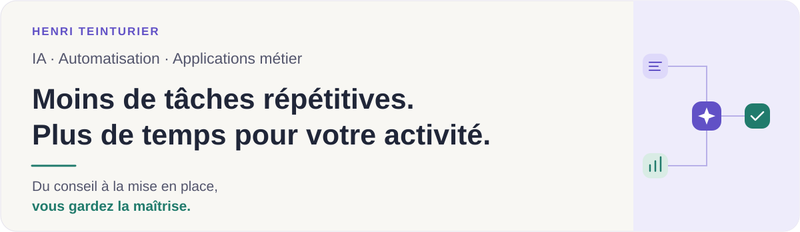
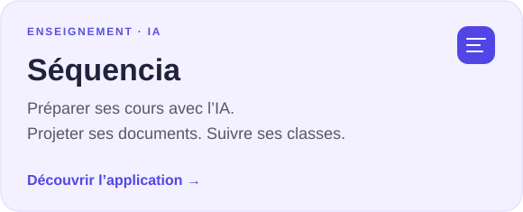
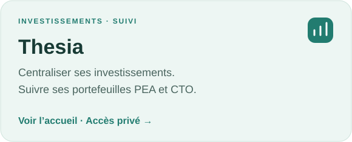

  

  
  &nbsp;
  

J’accompagne les **PME, startups et entrepreneurs** dans leurs usages de l’IA et la création d’outils adaptés à leur activité.

**Conseil IA · Automatisation · Applications sur mesure · Sites web**

Mon parcours réunit direction d’entreprise, développement en startup et enseignement. J’aime comprendre un besoin, construire une solution utile et la faire évoluer avec ses utilisateurs.

### Des besoins concrets, des applications

  
  

→ **[Séquencia : présentation, captures et architecture](https://github.com/HenriTeinturier/sequencia-presentation)**

L’IA fait partie de ma pratique depuis **2023**, de mes premiers essais avec ChatGPT et Copilot à l’intégration d’assistants dans mes applications. Aujourd’hui, je développe notamment avec **Codex et Claude Code**.

Ouvert aux **missions et aux opportunités en équipe** autour de l’IA, de l’automatisation et des applications métier. [Parlons de votre projet →](https://www.linkedin.com/in/henri-teinturier/)

### Mon activité sur GitHub

  
  

  
Langages de mes dépôts publics

   
  

